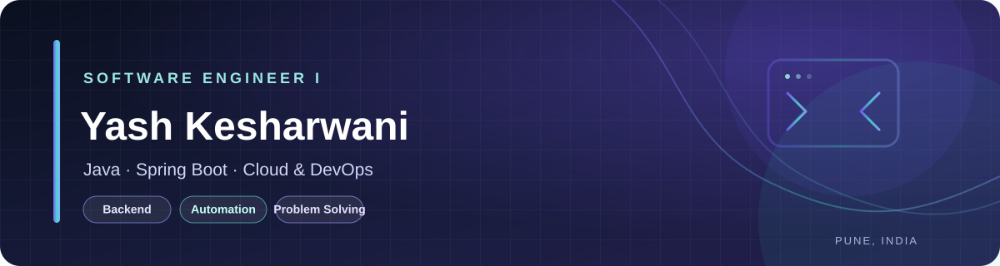

  

  
  
  
  

  

<h2 align="center">Software Engineer · Cognizant · Pune, India</h2>

  I build dependable software and help make the systems behind it more reliable. 
  My work spans Java and Spring Boot, REST APIs, cloud tooling, and infrastructure automation.

---

## 👋 About Me

- 💻 Software Engineer at **Cognizant**, working across infrastructure automation and reliable software delivery.
- ☕ Interested in **Java, Spring Boot, backend engineering, and REST APIs**.
- ☁️ Working with cloud and DevOps tooling, including **AWS, Azure DevOps, Linux, Docker, Kubernetes, Ansible, and Terraform**.
- 🧠 Solved **700+ LeetCode problems** and keep strengthening my data structures, algorithms, and problem-solving skills.
- 🎯 I enjoy learning by building projects, improving systems, and collaborating with other developers.

## 🧰 Tech Stack

  
  
  
  
  
  
  
  
  
  
  
  
  
  
  
  
  

## 🚀 Featured Projects

<table>
  <tr>
    <td width="50%" valign="top">
      <h3><a href="https://github.com/yashkesharwani559/ShareBite">🍱 ShareBite</a></h3>
      
A full-stack food distribution platform built around secure authentication, REST APIs, and a relational data layer.

      
Java · Spring Boot · Spring Security · React · MySQL · AWS

    </td>
    <td width="50%" valign="top">
      <h3><a href="https://github.com/yashkesharwani559/Sociogram">💬 SocioGram</a></h3>
      
A social web application built with Java web technologies and deployed during development on Apache Tomcat.

      
Java · Servlets · JSP · Apache Tomcat

    </td>
  </tr>
  <tr>
    <td width="50%" valign="top">
      <h3><a href="https://github.com/yashkesharwani559/Heart_Attack">📊 Heart Attack Prediction</a></h3>
      
A machine-learning project exploring data preparation, feature engineering, model tuning, and evaluation.

      
Python · Scikit-learn · TensorFlow · Pandas · NumPy

    </td>
    <td width="50%" valign="top">
      <h3><a href="https://github.com/yashkesharwani559/Use-cases-AWS_Devops">☁️ AWS & DevOps Use Cases</a></h3>
      
A hands-on collection of cloud and DevOps use cases. Browse the repository for individual examples and implementation details.

      
AWS · Cloud · DevOps

    </td>
  </tr>
</table>

  <a href="https://yashkesharwani559.github.io/portfolio/"><strong>Explore all projects, experience, and more on my portfolio →</strong></a>

## 🏅 Highlights

  
  
  
  

## 📈 GitHub Overview

  
  

  Stats cards are provided by GitHub Readme Stats; they may occasionally take time to load.

---

## 🤝 Let's Connect

I'm always glad to connect with developers, learn about interesting engineering problems, and collaborate on useful projects.

  
  
  

<i>Thanks for visiting my profile. Feel free to explore my repositories and say hello!</i>

